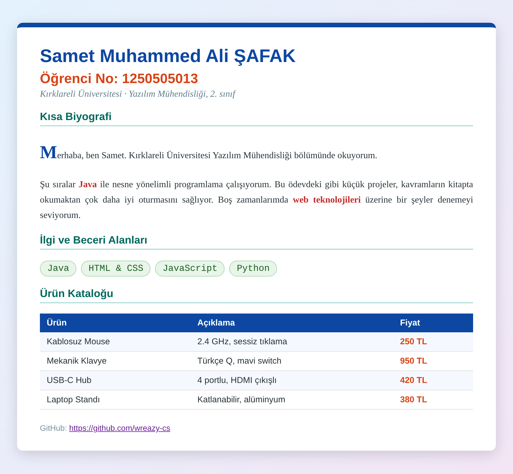

# W1: Java ile Basit Web Sunucusu

Sadece Java standart kütüphanesi ve soket programlama kullanılarak yazılmış basit bir HTTP web sunucusu. Hiçbir 3. parti kütüphane veya framework kullanılmamıştır. Sunucu **1989** portunu dinler ve herhangi bir tarayıcıdan bağlanıldığında ad soyad (H1), öğrenci numarası (H2) ve renk ile font gibi HTML bileşenleriyle biçimlendirilmiş kısa bir biyografi gösterir.

Bu proje bir Nesneye Yönelik Programlama dersi ödevi olarak hazırlanmıştır.

## Ekran Görüntüsü



## Özellikler

- `java.net.ServerSocket` ile 1989 portunda bağlantı kabul eder
- HTTP/1.1 istek satırını ve başlıklarını elle ayrıştırır
- `GET` ve `HEAD` isteklerini destekler, diğer yöntemlere `405` döner
- Bilinmeyen yollar için `404`, bozuk istekler için `400` döner
- Her bağlantıyı bir iş parçacığı havuzunda (`ExecutorService`) işler
- Sayfada basit bir ürün kataloğu tablosu da bulunur
- Türkçe karakterler için UTF-8 kullanır
- SOLID ilkelerine uygun, küçük ve tek sorumluluklu sınıflardan oluşur

## Gereksinimler

- JDK 17 veya üzeri (proje JDK 27 ile yapılandırılmıştır)
- Maven (isteğe bağlı, `javac` ile de derlenebilir)

## Çalıştırma

Maven ile:

```bash
mvn compile
java -cp target/classes webserver.Main
```

Sadece `javac` ile:

```bash
javac -encoding UTF-8 -d out $(find src/main/java -name "*.java")
java -cp out webserver.Main
```

Windows PowerShell için:

```powershell
javac -encoding UTF-8 -d out (Get-ChildItem -Recurse src/main/java -Filter *.java).FullName
java -cp out webserver.Main
```

IntelliJ IDEA kullanıyorsanız `Main` sınıfını açıp çalıştırmanız yeterlidir.

Sunucu başladıktan sonra tarayıcıdan şu adrese gidin:

```
http://localhost:1989
```

Sunucuyu durdurmak için terminalde `Ctrl + C` tuşlarına basın.

## Proje Yapısı

```
src/main/java/webserver/
├── Main.java                      Giriş noktası, nesneleri oluşturup birbirine bağlar
├── http/
│   ├── HttpRequest.java           Ayrıştırılmış istek (veri sınıfı)
│   ├── HttpRequestParser.java     Ham metni HttpRequest nesnesine çevirir
│   ├── HttpResponse.java          Yanıt (durum, tür, gövde)
│   ├── HttpResponseWriter.java    Yanıtı HTTP/1.1 biçiminde sokete yazar
│   ├── HttpStatus.java            Durum kodları (200, 400, 404, 405, 500)
│   └── BadRequestException.java   Geçersiz istek hatası
├── server/
│   ├── WebServer.java             Portu dinler, bağlantıları havuza devreder
│   ├── ConnectionHandler.java     Bağlantı işleyici arayüzü
│   └── HttpConnectionHandler.java Tek bir bağlantının yaşam döngüsü
├── routing/
│   ├── RequestHandler.java        İstek işleyici arayüzü
│   ├── Router.java                Yola göre işleyici seçer
│   └── NotFoundHandler.java       404 yanıtı üretir
└── page/
    ├── Profile.java               Sayfada gösterilen kişisel bilgiler
    ├── Product.java               Katalogdaki bir ürün (ad, açıklama, fiyat)
    ├── ProfileProvider.java       Bilgi kaynağı arayüzü
    ├── StaticProfileProvider.java Bilgiyi kod içinde tutan gerçekleştirim
    ├── PageRenderer.java          Sayfa üretici arayüzü
    ├── HtmlPageRenderer.java      Biçimlendirilmiş HTML üretir
    └── ProfilePageHandler.java    Ana sayfa isteğini karşılar
```

## İstek Akışı

1. `WebServer`, `accept()` ile yeni bir tarayıcı bağlantısı alır ve havuzdaki bir iş parçacığına verir.
2. `HttpConnectionHandler`, `HttpRequestParser` ile isteği okur.
3. `Router`, istenen yola uygun `RequestHandler` nesnesini seçer.
4. `ProfilePageHandler`, `ProfileProvider` ve `PageRenderer` yardımıyla HTML'i üretir.
5. `HttpResponseWriter`, yanıtı sokete yazar ve bağlantı kapatılır.

## SOLID İlkelerinin Uygulanışı

| İlke | Bu projedeki karşılığı |
| --- | --- |
| **S**ingle Responsibility | Her sınıfın tek işi var: `HttpRequestParser` sadece okur, `HttpResponseWriter` sadece yazar, `Router` sadece yönlendirir, `HtmlPageRenderer` sadece HTML üretir. |
| **O**pen/Closed | Yeni bir sayfa eklemek için `Router` değiştirilmez, sadece `register(...)` ile yeni bir `RequestHandler` kaydedilir. Yeni bir durum kodu için `HttpStatus` içine bir satır eklemek yeterlidir. |
| **L**iskov Substitution | `Router`, `ProfilePageHandler` ve `NotFoundHandler` birbirinin yerine kullanılabilir. Hepsi `RequestHandler` sözleşmesine uyar. |
| **I**nterface Segregation | Arayüzler tek bir metottan oluşur (`handle`, `getProfile`, `render`). Hiçbir sınıf kullanmadığı metodu uygulamaya zorlanmaz. |
| **D**ependency Inversion | Üst seviye sınıflar (`WebServer`, `HttpConnectionHandler`, `ProfilePageHandler`) somut sınıflara değil arayüzlere bağlıdır. Somut nesneler sadece `Main` içinde oluşturulur. |

## Yazar

**Samet Muhammed Ali ŞAFAK**, 1250505013
Kırklareli Üniversitesi, Yazılım Mühendisliği

GitHub: [wreazy-cs](https://github.com/wreazy-cs)
